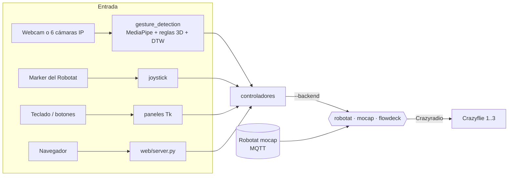

# Control de drones Crazyflie mediante gestos sobre el Robotat

Código del trabajo de graduación de **Albert Vandercam** (Universidad del Valle
de Guatemala). El sistema permite volar uno, dos o tres nanodrones
[Crazyflie 2.x](https://www.bitcraze.io/) dentro del **Robotat**, el ecosistema
de captura de movimiento del laboratorio, y mandarlos de forma natural: con
gestos del cuerpo o de la mano vistos por cámaras, con un marker usado como
joystick, con el teclado o desde un panel web.



**Cómo vuela.** La posición la cierra siempre el firmware del Crazyflie; Python
sólo manda objetivos o velocidades. Hay tres backends intercambiables con
`--backend` en todas las interfaces:

| Backend | Posicionamiento | Mando | Archivo |
|---|---|---|---|
| `robotat` (recomendado) | Robotat por MQTT → EKF del firmware en cada frame | high-level para despegar/aterrizar y paquete `hover` (velocidad) mientras dura la orden; ganancias validadas, CSV y gráficas PDF por sesión | [`controllers/shared/dron_robotat.py`](controllers/shared/dron_robotat.py) |
| `mocap` | Robotat por MQTT + `extpos` | `takeoff` / `go_to` / `land` del commander high-level | [`controllers/two_drones/cruz_highlevel_backend.py`](controllers/two_drones/cruz_highlevel_backend.py) |
| `flowdeck` | Flow deck v2, sin referencia absoluta | `MotionCommander` por velocidad | [`controllers/two_drones/flowdeck_dual_backend.py`](controllers/two_drones/flowdeck_dual_backend.py) |

**Cómo se reconocen los gestos.** MediaPipe extrae el esqueleto del operador;
los gestos estáticos se clasifican con reglas sobre el cuerpo en 3D y los
dinámicos con plantillas y *Dynamic Time Warping*. Con seis cámaras IP del
techo, el sistema elige en cada momento la que mejor ve al operador.

## Estructura del repositorio

| Ruta | Contenido |
|---|---|
| [`controllers/single_drone/`](controllers/single_drone/README.md) | Un dron: panel de teclado del núcleo nuevo (`robotat/`), control por cámara y gestos (`camera/`), botones (`buttons/`) y una prueba de hover con Flow deck |
| [`controllers/two_drones/`](controllers/two_drones/README_CONTROL_CRUZ_PYTHON.md) | Backends de vuelo, paneles de dos y tres drones, formación por cámara, sesión del panel web, telemetría y análisis |
| [`controllers/joystick/`](controllers/joystick/README.md) | Marker del Robotat como joystick 3D y seguimiento de un marker |
| [`controllers/shared/`](controllers/shared/README.md) | Núcleo por dron (`dron_robotat.py`), lectura del mocap, radios, EKF, teclado, CSV y análisis de sesiones |
| [`external/gesture_detection/`](external/gesture_detection/README.md) | Visión independiente del dron: pose, manos, vocabulario de gestos, multicámara, cámaras IP (RTSP), PTZ y grabación |
| [`external/mapeo3d/`](external/mapeo3d/README.md) | Percepción 3D del operador con varias cámaras: calibración y triangulación al marco del Robotat |
| [`web/`](web/README.md) | Panel web local (servidor HTTP + HTML/JS) que llama a los controladores |
| [`models/`](models) | Plantillas de gestos dinámicos ya entrenadas (`.npz`) |
| [`tests/`](tests) | Pruebas de integración; cada categoría tiene además su `tests/` |
| [`results/`](results/README.md) | Gráficas y capturas de las sesiones de vuelo (los CSV y vídeos no se versionan) |
| [`docs/`](docs/agents/README.md) | Arquitectura, operación, pipeline de gestos y decisiones de diseño |
| [`thesis/`](thesis) | Fuentes LaTeX y figuras del trabajo escrito |
| [`Tesis/`](Tesis/Inicio.md) | Vault de Obsidian: tareas, bitácora diaria, decisiones e informes de análisis |
| `control_dron_camara.py`, `control_dos_drones_camara.py` | Lanzadores cortos de los controladores por cámara |

## Requisitos

**Software:** Windows 10/11 con PowerShell y Python 3.12 (probado; MediaPipe 0.10.14).
Dependencias en [`requirements.txt`](requirements.txt).

**Hardware para volar:** Crazyflie 2.x con marcadores del Robotat (o Flow deck v2),
una Crazyradio PA por cada uno o dos drones, acceso al broker MQTT del Robotat y,
para gestos, una webcam o las cámaras IP Amcrest del laboratorio. Todo lo demás
(reconocimiento, paneles, panel web, pruebas) funciona sin hardware con `--dry-run`.

## Instalación

```powershell
git clone https://github.com/AlbertVaner/tesis.git
cd tesis
python -m venv .venv
.\.venv\Scripts\Activate.ps1
python -m pip install -r requirements.txt
copy .env.example .env   # sólo si se usan cámaras IP: llenar CAM_HOST, CAM_PASSWORD...
```

## Uso rápido

Todos los comandos se ejecutan desde la raíz con el entorno activado. Los
marcados *sin dron* no abren radio ni motores.

```powershell
# Practicar el vocabulario de gestos con la webcam, con acierto y latencia (sin dron)
python .\external\gesture_detection\probar_gestos_3d.py --practica

# Volar el Dron 1 con gestos del cuerpo, simulado (sin dron)
python .\controllers\single_drone\camera\control_camara_dron1.py --reconocedor vocabulario --backend robotat --volar --dry-run

# Lo mismo con las seis cámaras IP del .env y dos drones en formación (sin dron)
python .\controllers\single_drone\camera\control_camara_dron1.py --multicamara --dron ambos --backend robotat --volar --dry-run

# Teclado: un dron, dos o tres sobre el núcleo nuevo (quitar --dry-run para volar)
python .\controllers\single_drone\robotat\control_dron_robotat.py --dron 1 --dry-run
python .\controllers\two_drones\control_dos_drones_robotat.py --dry-run

# Panel web local en http://127.0.0.1:8765
python .\web\server.py --dry-run
```

Cada lanzador documenta sus opciones con `--help`. Las guías completas están en
el README de cada carpeta.

> **Antes de un vuelo real:** confirmar URI y Crazyradio, espacio libre, baterías,
> que el Robotat vea los rigid bodies y tener a mano el paro de emergencia
> (tecla **R** en los paneles; gesto de paro en cámara).

## Resultados

Cada sesión con el núcleo `robotat` deja un CSV en `results/data/dron_robotat/<día>/`
y, al cerrar, gráficas PDF (altura, trayectoria XY, error EKF vs. mocap, batería,
comandos y vuelo 3D) en `results/graphs/dron_robotat/<día>/<sesión>/`. Se
regeneran a mano con:

```powershell
python .\controllers\shared\analizar_sesion_robotat.py <ruta_al_csv>
```

## Validación sin hardware

```powershell
python -m compileall controllers external web control_dron_camara.py control_dos_drones_camara.py
python -m pytest -q
```

Las pruebas no abren cámara, radio ni motores.

## Documentación

- [Arquitectura y dependencias](docs/agents/architecture.md) · [Operación y seguridad](docs/agents/operations.md) · [Pipeline de gestos](docs/agents/gesture_pipeline.md)
- [Controlador sobre el Robotat, desde cero](controllers/single_drone/robotat/README.md) · [Control por cámara](controllers/single_drone/camera/README.md) · [Control de la cruz](controllers/two_drones/README_CONTROL_CRUZ_PYTHON.md)
- [Plan de reconocimiento de gestos](docs/plan_reconocimiento_gestos_robotat.md) · [Refactorización de septiembre de 2026](docs/agents/refactor_2026-09.md)
- [AGENTS.md](AGENTS.md): reglas de organización del código y de seguridad del hardware.
